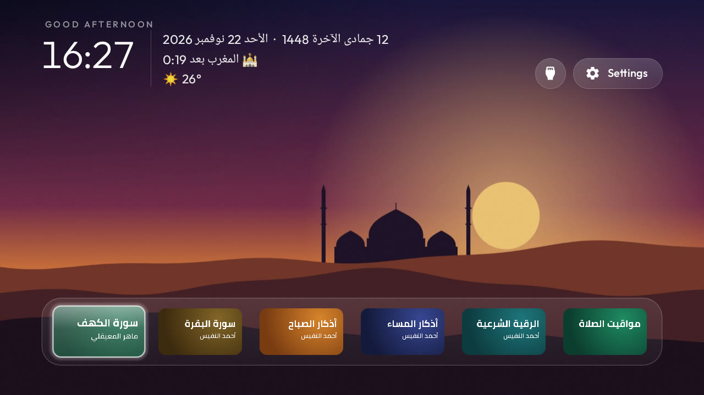
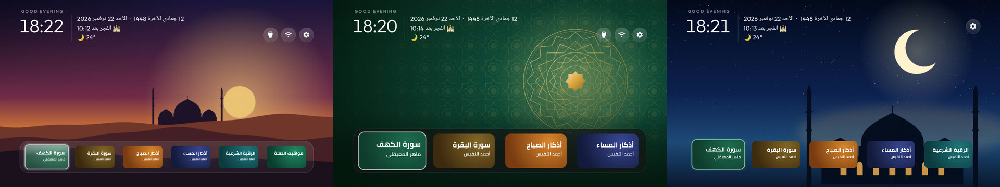

<p align="center">
  
</p>

<div dir="rtl">

<h1 align="center">Salahi TV</h1>

<p align="center">
  <strong>شاشة رئيسية إسلامية لتلفزيونات Android TV وGoogle TV</strong><br>
  مواقيت الصلاة والأذان والقرآن والأذكار في مكان واحد، بدون إعلانات.
</p>

<p align="center">
  <a href="#remote">التحكم من الموبايل</a> ·
  <a href="#features">المميزات</a> ·
  <a href="#adhan">الأذان والتنبيهات</a> ·
  <a href="#themes">المظهر</a> ·
  <a href="#supported">التلفزيونات المدعومة</a> ·
  <a href="#install">التثبيت</a> ·
  <a href="#faq">الأسئلة الشائعة</a>
</p>

---

## نظرة عامة

يحوّل Salahi TV تلفزيونك إلى شاشة هادئة تساعدك على متابعة الصلاة والورد اليومي. تعرض الشاشة التاريخ الهجري والميلادي، والصلاة القادمة، ودرجة الحرارة، مع بطاقات للقرآن والأذكار تعمل دون إنترنت.

قنواتك وتطبيقاتك تبقى في مكانها: **اضغط السهم لأسفل في الريموت** لتظهر مباشرة.

<a name="remote"></a>
## موبايلك ريموت وكيبورد للتلفزيون

لا حاجة بعد الآن لكتابة كل حرف بالريموت على لوحة الشاشة. باستخدام تطبيق **Google TV** الرسمي يصبح موبايلك ريموت كاملًا، وتكتب بكيبورد الموبايل في البحث وكلمات المرور وأي خانة نص.

1. ثبّت التطبيق من [Google Play](https://play.google.com/store/apps/details?id=com.google.android.videos) أو [App Store](https://apps.apple.com/app/id746894884).
2. تأكد أن الموبايل والتلفزيون على شبكة الواي فاي نفسها.
3. افتح التطبيق، واضغط زر **الريموت**، ثم اختر تلفزيونك.
4. اكتب الرمز الذي يظهر على التلفزيون.
5. عند الحاجة إلى الكتابة، اضغط أيقونة **الكيبورد** في شاشة الريموت.

<a name="features"></a>
## المميزات

<table>
<tr>
<td width="52%"></td>
<td>
<h3>القرآن والأذكار بضغطة واحدة</h3>
سورة الكهف، وسورة البقرة، وأذكار الصباح والمساء، والرقية الشرعية. اختر البطاقة ويبدأ الصوت مباشرة من التلفزيون، دون إنترنت ودون إعلانات.
<br><br>
<b>مشغّل سهل بالريموت:</b> تشغيل وإيقاف، وتقديم أو إرجاع 30 ثانية، مع المتابعة تلقائيًا من حيث توقفت.
</td>
</tr>
<tr>
<td></td>
<td>
<h3>الأذان في وقته</h3>
مواقيت حسب مدينتك وطريقة الحساب المناسبة لبلدك، بصوت المؤذن الذي تختاره، مع تسجيل خاص لأذان الفجر.
</td>
</tr>
<tr>
<td></td>
<td>
<h3>تذكير لطيف</h3>
تذكير بالصلاة على النبي ﷺ كل 45 دقيقة، وبسورة الكهف يوم الجمعة، دون أن يظهر فوق التطبيقات المفتوحة.
</td>
</tr>
</table>

**وأيضًا:**

- **تلفزيون أنظف:** تُعطَّل التطبيقات الدعائية التي توافق عليها فقط، ويمكن إعادتها في أي وقت.
- **قنواتك وتطبيقاتك كما هي:** تظهر بالضغط على السهم لأسفل في الريموت.
- **معلومات يومك أمامك:** التاريخ الهجري والميلادي، والوقت المتبقي للصلاة القادمة، ودرجة الحرارة.
- **أزرار سريعة:** HDMI والواي فاي والإعدادات في أعلى الشاشة، مع زر Google Assistant إذا كان متوفرًا على تلفزيونك.

<a name="adhan"></a>
## الأذان والتنبيهات

يتصرف التطبيق حسب ما يظهر على الشاشة وقت الصلاة:

| ما يظهر على الشاشة | التنبيه | صوت الأذان |
|---|---|---|
| **الشاشة الرئيسية** | شريط واضح | الأذان كاملًا |
| **شاشة التوقف** | يستمر الأذان دون انقطاع | الأذان كاملًا |
| **أي تطبيق** | شريط تنبيه | الأذان كاملًا |
| **HDMI أو القنوات** | سطر صغير أسفل الشاشة | مطلع الأذان فقط |

لصلاة الفجر تسجيل خاص يتضمن «الصلاة خير من النوم». وإذا كنت تستمع إلى بطاقة قرآن أو أذكار، يتوقف الصوت أثناء الأذان ثم يكمل تلقائيًا.

<a name="themes"></a>
## المظهر

<p align="center">
  
</p>

اختر بين **أوقات اليوم** بخلفية تتغير مع الصباح والمساء والليل، أو **الزخرفة** الخضراء والذهبية، أو **مسجد الليل**. ويمكنك أيضًا استخدام صورتك الخاصة.

<a name="supported"></a>
## التلفزيونات المدعومة

العبرة بنظام التشغيل وليس بالماركة: يعمل Salahi TV على أي جهاز بنظام **Android TV أو Google TV، إصدار أندرويد 8 أو أحدث**. للتأكد، افتح الإعدادات ثم **About** وابحث عن Android TV OS أو Google TV.

| النوع | الحالة |
|---|---|
| **تلفزيونات Android TV وGoogle TV** من TCL وSony وXiaomi وPhilips وSharp وPanasonic وToshiba وHaier وSkyworth وJVC وMotorola وOnePlus وغيرها | ✅ مدعومة |
| **أجهزة البث بالنظام نفسه**، مثل NVIDIA Shield وXiaomi Mi Box | ✅ مدعومة |
| **Hisense** | ✅ موديلات Android TV وGoogle TV فقط، و❌ موديلات VIDAA |
| **بعض موديلات TCL للسوق الصيني** | ❌ لا تقبل تغيير الشاشة الرئيسية |
| **Fire TV** | ❌ لا يسمح بتغيير الشاشة الرئيسية |
| **Samsung (Tizen) وLG (webOS) وRoku وVizio** | ❌ غير مدعومة |

جُرّب Salahi TV بالكامل على تلفزيون TCL. أما توافق باقي الماركات فيعتمد على [قوائم CleanYourTV](https://github.com/Gathin23/cleanyourtv/tree/main/examples) المجرّبة لكل موديل.

<a name="install"></a>
## التثبيت

**المتطلبات**

- تلفزيون يعمل بنظام Android TV أو Google TV، إصدار أندرويد 8 أو أحدث.
- كمبيوتر Windows أو Mac عليه [Claude Code](https://claude.com/claude-code).
- اتصال التلفزيون والكمبيوتر بشبكة الواي فاي نفسها.
- مساحة فارغة تقارب 130 ميجابايت على التلفزيون.

**الخطوات**

1. افتح Claude Code والصق الأمر التالي:

   ```text
   نضّف تلفزيوني بـ github.com/Mahmoodsalah/Salahi-tv واقرا skills/salahi-tv/SKILL.md وامشِ عليه خطوة خطوة
   ```

2. فعّل **USB debugging** من خيارات المطوّر عندما يُطلب منك ذلك.
3. راجع كل خطوة ووافق عليها قبل تنفيذها، ثم اختر مدينتك والمؤذن وشكل الشاشة.

<details>
<summary>التثبيت كإضافة في Claude Code</summary>

```text
/plugin marketplace add Mahmoodsalah/Salahi-tv
/plugin install salahi-tv@salahi-tv
```

</details>

<a name="faq"></a>
## الأسئلة الشائعة

<details>
<summary>هل سيحذف تطبيقاتي؟</summary>

لا، لا يُحذف أي تطبيق. تظهر لك قائمة بالتطبيقات الدعائية وتطبيقات الشركة غير الضرورية، ويُعطَّل منها ما توافق عليه فقط. أما التطبيقات التي تستخدمها فتبقى كما هي، وتُحفظ نسخة احتياطية على جهازك قبل أي تغيير.
</details>

<details>
<summary>أين أجد القنوات والتطبيقات بعد التثبيت؟</summary>

في مكانها. اضغط السهم لأسفل في الريموت من الشاشة الرئيسية لتظهر، ويمكنك الوصول إلى مصادر HDMI من الزر الموجود أعلى الشاشة.
</details>

<details>
<summary>كيف أرجع التلفزيون كما كان؟</summary>

فعّل USB debugging، ثم شغّل ملف <code>restore.sh</code> من مجلد النسخة الاحتياطية لإعادة التطبيقات المعطّلة والشاشة الأصلية.
</details>

<details>
<summary>هل يعمل على Samsung أو LG؟</summary>

لا، لأن نظامي Tizen وwebOS لا يدعمان الأدوات المطلوبة. يعمل Salahi TV على أجهزة Android TV وGoogle TV فقط، وتجد التفاصيل في <a href="#supported">التلفزيونات المدعومة</a>.
</details>

<details>
<summary>هل يظهر زر Google Assistant على كل التلفزيونات؟</summary>

لا. يُفحص التلفزيون أثناء التثبيت: إذا كان فيه Google Assistant يُضاف الزر في أول الأزرار من اليسار، وإذا لم يكن موجودًا فلا يُضاف، وتبقى بقية الأزرار تعمل بشكل طبيعي.
</details>

<details>
<summary>هل ملفات الصوت موجودة في المستودع؟</summary>

لا، تُنزَّل على جهازك أثناء التثبيت للاستخدام الشخصي.
</details>

## شكر

مبني على [CleanYourTV](https://github.com/Gathin23/cleanyourtv) و[noor-tv](https://github.com/majedphotos/noor-tv) (رخصة MIT) ✨. مواقيت الصلاة والتاريخ الهجري من [Aladhan](https://aladhan.com/)، والطقس من [Open-Meteo](https://open-meteo.com/).

</div>
