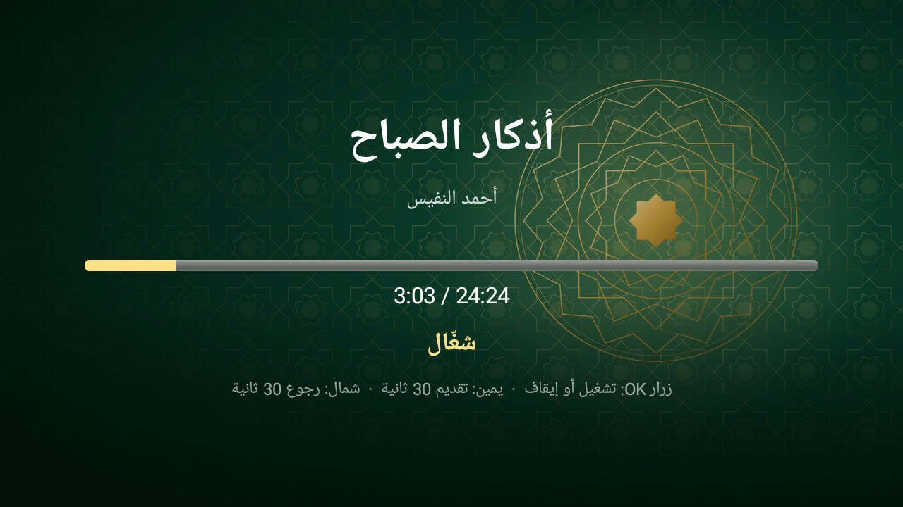
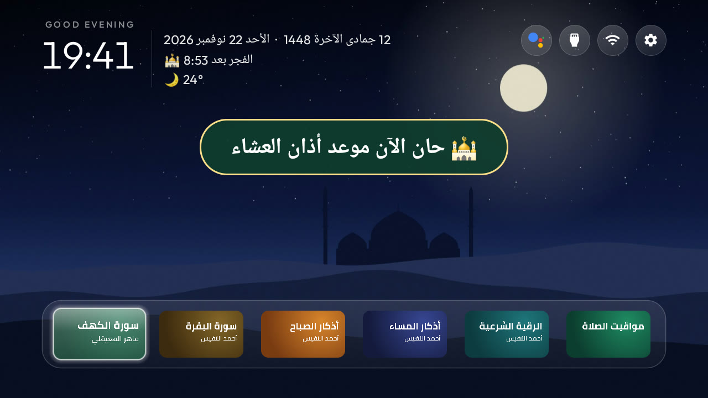
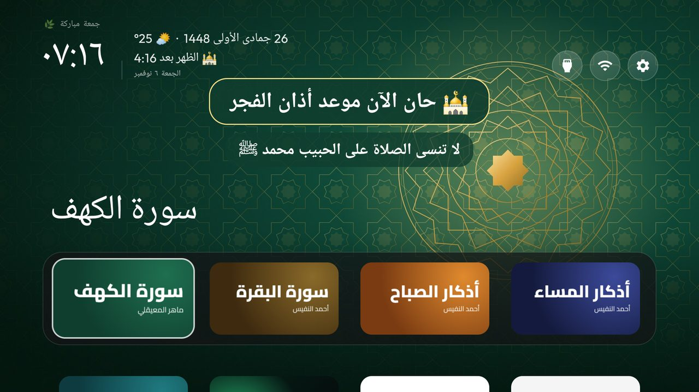

<div dir="rtl" align="center">

# 📺 Salahi TV

### نضّف تلفزيونك من الإعلانات، وخليه يأذّن ويذكّرك بالصلاة

كلود بيعمل كل حاجة، ويمشّيك خطوة خطوة بكلام بسيط.


**[⬇️ ابدأ دلوقتي، 3 خطوات بس](#start)**

</div>

<div dir="rtl">

## هتاخد إيه؟

<table>
<tr>
<td width="33%"><br><b>📖 القرآن والأذكار</b><br>بيشتغلوا من على التلفزيون، من غير إنترنت ولا إعلانات.</td>
<td width="33%"><br><b>🕌 الأذان</b><br>بيأذّن وقت الصلاة، ولو فيلم شغال بيظهر تنبيه بس.</td>
<td width="33%"><br><b>🌿 يوم الجمعة</b><br>بيذكّرك بسورة الكهف والصلاة على النبي ﷺ.</td>
</tr>
</table>

### وكمان

- 🧹 **من غير إعلانات:** بيعطّل تطبيقات الشركة اللي بتجمع بياناتك وتعرض إعلانات (**تعطيل مش حذف**، وترجع بأمر واحد)
- 🗓️ **جنب الساعة:** التاريخ الهجري والميلادي، والصلاة الجاية بعد قد إيه، ودرجة الحرارة
- 📖 **كروت بضغطة واحدة:** سورة الكهف، سورة البقرة، أذكار الصباح، أذكار المساء، والرقية الشرعية. اختار الكارت والصوت يشتغل على طول، من غير ما يفتح يوتيوب ومن غير إعلانات تقطع عليك
- ▶️ **مشغّل بسيط:** تشغيل وإيقاف، وتقديم ورجوع 30 ثانية، وبيفتكر وقفت فين
- 🎮 **وقت البلايستيشن:** على HDMI بيظهر سطر صغير تحت 3 ثواني، وأول جملة من الأذان بس
- ﷺ **كل 45 دقيقة:** تذكير بالصلاة على النبي، ومش بيظهر فوق التطبيقات
- 🌙 **شاشة التوقف** ما بتقطعش الأذان

## الجديد في النسخة دي

| | noor-tv | Salahi TV |
|---|---|---|
| **القرآن والأذكار** | بيفتحوا يوتيوب | صوت محفوظ على التلفزيون |
| **جنب الساعة** | الهجري والطقس | الهجري والميلادي والصلاة والحرارة |
| **الأذان وقت الألعاب** | شريط كبير | سطر صغير وأول جملة بس |
| **التذكير** | فوق أي حاجة شغالة | الشاشة الرئيسية وHDMI بس |
| **شاشة التوقف** | بتقطع الأذان | الأذان بيكمّل |
| **صفحة الجوال** | مفتوحة من غير باسورد | اتشالت |
| **الشاشة الرئيسية** | اسم كبير وصف ظاهر نصه | شريط الكروت بس |

## 🎨 3 أشكال تختار منها


| الشكل | بيتميز بإيه |
|---|---|
| **الزخرفة** | أخضر وذهبي، وأزرار أيقونات دايرية |
| **مسجد الليل** | سما كحلية وهلال ومسجد، وأخف اختيار |
| **أوقات اليوم** | مسجد في الصحرا، والخلفية بتتغيّر الصبح والعصر والليل |

وتقدر تغيّر الشكل في أي وقت، أو تحط صورتك خلفية.

## بيشتغل على إيه؟

✅ أندرويد تي في وجوجل تي في بس (TCL، سوني، شاومي، هايسنس أندرويد، فيليبس أندرويد...)

❌ سامسونج وإل جي ما بيشتغلش عليهم، لأن أنظمتهم مش أندرويد

## محتاج إيه؟

1. لابتوب (ماك أو ويندوز) عليه [Claude Code](https://claude.com/claude-code)
2. التلفزيون واللابتوب على **نفس الواي فاي**
3. حوالي **130 ميجا** فاضية على التلفزيون للقرآن والأذكار

<a name="start"></a>
## 🚀 الطريقة: 3 خطوات بس

**1. افتح Claude Code والصق السطر ده:**

```
نضّف تلفزيوني بـ github.com/Mahmoodsalah/Salahi-tv واقرا skills/salahi-tv/SKILL.md وامشِ عليه خطوة خطوة
```

**2. اعمل اللي هيقولهولك.** خطوة واحدة كل مرة. الحاجة الوحيدة اللي هتعملها بإيدك إنك تدوس 7 مرات في إعدادات التلفزيون عشان تفعّل «خيارات المطوّر»، وكلود هيقولك فين بالظبط.

**3. خلاص.** كلود هيدوّر على تلفزيونك بنفسه، ويديك تقرير بكل حاجة عطّلها.

<details>
<summary>عايزه كـ plugin في Claude Code؟</summary>

```
/plugin marketplace add Mahmoodsalah/Salahi-tv
/plugin install salahi-tv@salahi-tv
```

بعدها قول لكلود: «نضّف تلفزيوني».
</details>

## ⚠️ اقرا قبل ما تبدأ

- **تعطيل مش حذف.** فيه ناس بوّظت تلفزيوناتها لما حذفت تطبيقات النظام. هنا مفيش حاجة بتتحذف.
- قبل أي تغيير بتتحفظ نسخة احتياطية على جهازك، ومعاها أمر بيرجّع التطبيقات والشاشة الأصلية.
- كلود بيستأذنك قبل كل دفعة تعطيل.
- ملفات الصوت مش موجودة في الريبو. بتتحمّل على جهازك وقت التركيب لاستخدامك الشخصي.
- الاستخدام على مسؤوليتك.

## شكر

مبني على [CleanYourTV](https://github.com/Gathin23/cleanyourtv) و[noor-tv](https://github.com/majedphotos/noor-tv) (رخصة MIT) ✨.
مواقيت الصلاة والتاريخ الهجري من [Aladhan](https://aladhan.com/)، والطقس من [Open-Meteo](https://open-meteo.com/).

</div>
