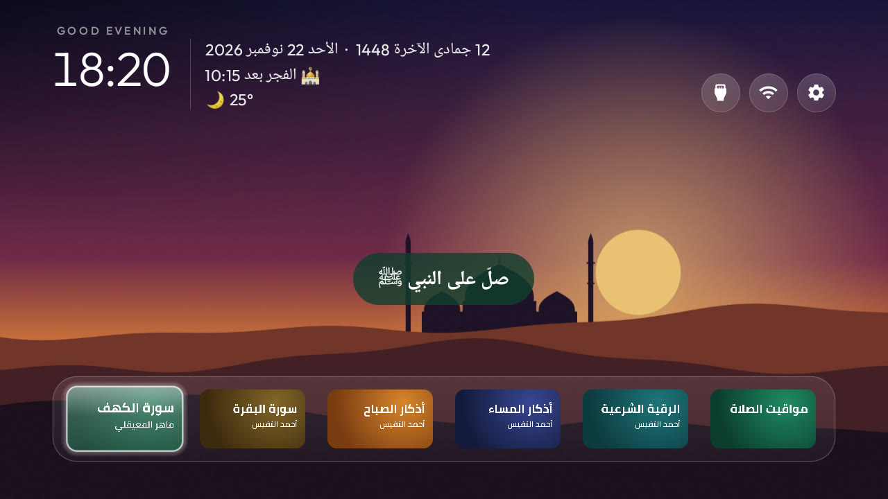

<p align="center">
  
</p>

<div dir="rtl">

<h1 align="center">Salahi TV</h1>

<p align="center">
  <strong>شاشة رئيسية إسلامية لتلفزيونات Android TV وGoogle TV</strong><br>
  مواقيت الصلاة والأذان والقرآن والأذكار في مكان واحد، بدون إعلانات.
</p>

<p align="center">
  <a href="#features">المميزات</a> ·
  <a href="#adhan">الأذان والتنبيهات</a> ·
  <a href="#themes">المظهر</a> ·
  <a href="#install">التثبيت</a> ·
  <a href="#faq">الأسئلة الشائعة</a>
</p>

---

## نظرة عامة

يحوّل Salahi TV تلفزيونك إلى شاشة هادئة تساعدك على متابعة الصلاة والورد اليومي. يعطّل التطبيقات الدعائية دون حذفها، ويضيف شاشة رئيسية بالتاريخ الهجري والميلادي، والصلاة القادمة، ودرجة الحرارة، مع بطاقات للقرآن والأذكار تعمل مباشرة من التلفزيون.

<a name="features"></a>
## المميزات

<table>
<tr>
<td width="52%"></td>
<td>
<h3>القرآن والأذكار بضغطة واحدة</h3>
سورة الكهف، سورة البقرة، أذكار الصباح، أذكار المساء، والرقية الشرعية. اختر البطاقة ويبدأ الصوت مباشرة، دون فتح يوتيوب ودون إعلانات تقطع عليك.
<br><br>
<b>مشغّل صوتي سهل الاستخدام:</b> تحكّم بالريموت في التشغيل والإيقاف، وتقديم أو إرجاع المقطع 30 ثانية، مع استكمال الاستماع تلقائيًا من حيث توقفت.
</td>
</tr>
<tr>
<td></td>
<td>
<h3>الأذان في وقته</h3>
مواقيت حسب مدينتك وطريقة الحساب المناسبة لبلدك، مع أذان بالصوت الذي تختاره. ولا تقطع شاشة التوقف الأذان أثناء تشغيله.
</td>
</tr>
<tr>
<td></td>
<td>
<h3>تذكير لطيف</h3>
تذكير بالصلاة على النبي ﷺ كل 45 دقيقة، وبسورة الكهف يوم الجمعة، دون الظهور فوق التطبيقات المفتوحة.
</td>
</tr>
</table>

**وأيضًا:**

- **تلفزيون أنظف:** تعطيل تطبيقات الشركة والإعلانات دون حذف أي شيء، مع إمكانية إعادتها.
- **معلومات يومك أمامك:** التاريخ الهجري والميلادي، والوقت المتبقي للصلاة القادمة، ودرجة الحرارة.
- **اختصارات واضحة:** أزرار HDMI والواي فاي والإعدادات في أعلى الشاشة.

<a name="adhan"></a>
## الأذان والتنبيهات

يتصرف التطبيق حسب ما يظهر على الشاشة وقت الصلاة:

| ما يظهر على الشاشة | التنبيه | صوت الأذان |
|---|---|---|
| **الشاشة الرئيسية** | شريط واضح | الأذان كاملًا |
| **شاشة التوقف** | يستمر الأذان دون انقطاع | الأذان كاملًا |
| **HDMI أو القنوات** | تنبيه في أسفل الشاشة | مطلع الأذان |
| **تطبيق آخر** | شريط تنبيه | بدون صوت |
| **صلاة الفجر** | تنبيه فقط | بدون صوت |

<a name="themes"></a>
## المظهر

<p align="center">
  
</p>

اختر بين **أوقات اليوم** بخلفية تتغير مع الصباح والمساء والليل، أو **الزخرفة** الخضراء والذهبية، أو **مسجد الليل**. ويمكنك أيضًا استخدام صورتك الخاصة.

<a name="install"></a>
## التثبيت

**المتطلبات**

- تلفزيون يعمل بنظام Android TV أو Google TV.
- كمبيوتر Windows أو Mac عليه [Claude Code](https://claude.com/claude-code).
- اتصال التلفزيون والكمبيوتر بشبكة الواي فاي نفسها.
- مساحة فارغة تقارب 130 ميجابايت على التلفزيون.

**الخطوات**

1. افتح Claude Code والصق الأمر التالي:

   ```text
   نضّف تلفزيوني بـ github.com/Mahmoodsalah/Salahi-tv واقرا skills/salahi-tv/SKILL.md وامشِ عليه خطوة خطوة
   ```

2. فعّل **USB debugging** من خيارات المطوّر عندما يطلب منك ذلك.
3. وافق على كل خطوة قبل تنفيذها، واختر مدينتك والمؤذن وشكل الشاشة.

<details>
<summary>التثبيت كإضافة في Claude Code</summary>

```text
/plugin marketplace add Mahmoodsalah/Salahi-tv
/plugin install salahi-tv@salahi-tv
```

</details>

<a name="faq"></a>
## الأسئلة الشائعة

<details>
<summary>هل يحذف تطبيقات من التلفزيون؟</summary>

لا. يتم تعطيل التطبيقات فقط، وتُحفظ نسخة احتياطية على جهازك قبل أي تغيير.
</details>

<details>
<summary>كيف أرجع التلفزيون كما كان؟</summary>

فعّل USB debugging، ثم شغّل ملف <code>restore.sh</code> من مجلد النسخة الاحتياطية لإعادة التطبيقات المعطلة والشاشة الأصلية.
</details>

<details>
<summary>هل يعمل على Samsung أو LG؟</summary>

لا. يعمل على أجهزة Android TV وGoogle TV فقط.
</details>

<details>
<summary>هل ملفات الصوت موجودة في المستودع؟</summary>

لا. يتم تنزيلها على جهازك أثناء التثبيت للاستخدام الشخصي.
</details>

## شكر

مبني على [CleanYourTV](https://github.com/Gathin23/cleanyourtv) و[noor-tv](https://github.com/majedphotos/noor-tv) (رخصة MIT) ✨.
مواقيت الصلاة والتاريخ الهجري من [Aladhan](https://aladhan.com/)، والطقس من [Open-Meteo](https://open-meteo.com/).

</div>
